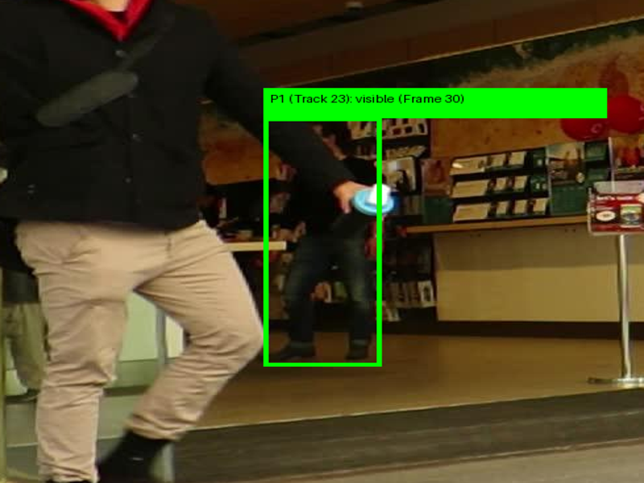
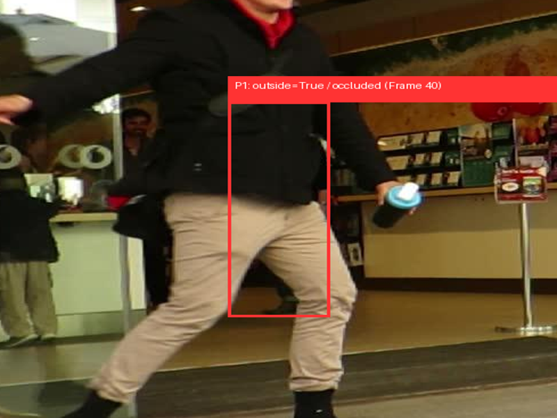
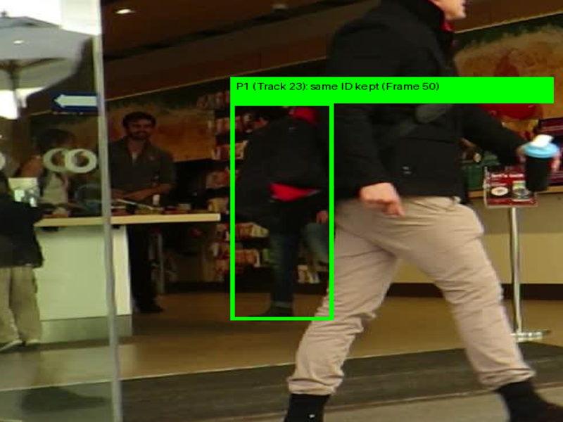

# Báo cáo cá nhân — HoangThuanThien-2A202603270

Đoạn video: MOT17-09, 150 frame (frame 1–150), nguồn MOTChallenge, giấy phép CC BY-NC-SA 3.0.

## 0. Thông tin học viên

- Họ tên: Hoàng Thuận Thiên
- MSSV: 2A202603270
- Mã đề (A/B/C): **C**
- Email: thienhoang20803@gmail.com
- Link repository: https://github.com/Tiny208/K5-L2B-HoangThuanThien-2A202603270-MOTTracking
- Giờ bắt đầu: 16:30
- Giờ kết thúc: 18:15

## 1. Xem trước đoạn video (CP0)

Ghi **trước khi vẽ**, mỗi người một dòng (5 người P1–P5 theo đúng Đề C).

| Mã | Frame xuất hiện | Frame cuối thấy được | Rẽ / dừng / đổi tốc độ ở frame | Bị che ở frame | Ghi chú |
|---|---|---|---|---|---|
| P1 | 0 | 149 | ~30 (đổi hướng), ~90 (chậm lại) | 40–49 (bị cột/người che khuất) | Đối tượng trọng tâm CP2; theo dõi kỹ đoạn che |
| P2 | 60 | 149 | ~70 (tăng tốc nhẹ), ~120 | Ít | Xuất hiện muộn ở frame 60 tại nửa bên trái |
| P3 | 0 | 149 | ~40–50 (vào sâu trong khung hình) | Ít | Đi từ mép phải sang trái, box to dần khi lại gần |
| P4 | 0 | 110 | ~35 (đổi tốc độ) | Không | Đi từ giữa khung hình, ra khỏi khung ở frame 110 |
| P5 | 0 | 149 | ~28 (đổi hướng), ~110 | 120–128, 139–148 | Đi sát mép trái, có 2 đoạn ra mép khung hình |

## 2. Keyframe và thời gian (CP1, CP4)

Số keyframe lấy từ kết quả `src/check_submission.py`.

| Mã | Số keyframe | Keyframe ở frame | Số frame có mặt | Keyframe / 100 frame | Thời gian (phút) | Chỗ khó |
|---|---|---|---|---|---|---|
| P1 | 15 | 0, 10, 20, 30, 50, 60, 70, 80, 90, 100, 110, 120, 130, 140, 149 | 140 | 10.7 | 15 | Đoạn che khuất frame 40–49; giữ cùng ID |
| P2 | 14 | 60, 69, 70, 79, 80, 90, 100, 110, 119, 120, 129, 130, 140, 149 | 90 | 15.6 | 12 | Xuất hiện giữa chừng, cần bắt đúng frame 60 |
| P3 | 16 | 0, 10, 20, 30, 40, 50, 60, 70, 80, 90, 100, 110, 120, 130, 140, 149 | 150 | 10.7 | 12 | Box thay đổi kích thước khi lại gần camera |
| P4 | 6 | 0, 10, 20, 30, 40, 70 | 110 | 5.5 | 8 | Ra khỏi khung hình trước frame 110 |
| P5 | 16 | 0, 10, 20, 30, 40, 50, 60, 70, 80, 90, 100, 110, 119, 129, 130, 149 | 131 | 12.2 | 13 | Mép trái phức tạp, có 2 lần bật outside |
| **Tổng** | **67** | | **621** | | **60** | |

Keyframe / 100 frame của cả bài = tổng keyframe ÷ tổng số frame có mặt × 100 = 67 ÷ 621 × 100 ≈ **10.8**

Bạn đặt keyframe nhiều nhất ở người nào? Vì sao (người đó rẽ, dừng, lại gần camera hay bị che)?

Đặt keyframe nhiều nhất ở P3, P5 (16 keyframe) và P2 (mật độ cao nhất 15.6 keyframe/100 frame). Đối với P2, do xuất hiện từ frame 60 và di chuyển qua khu vực đông người đi bộ nên cần phân bổ keyframe dày quanh các frame 69–70 và 119–120 để box nội suy không cắt góc. Đối với P1, cần kiểm soát kỹ quanh đoạn bị che khuất ở frame 40 để bật cờ outside chính xác.

## 3. Đoạn bị che (CP2)

Người bị che: **`P1`** (Target 1 — Người trọng tâm CP2 của Đề C)

| Mốc | Frame |
|---|---:|
| Bắt đầu bị che một phần (bật `occluded`) | 35 |
| Mất hẳn (bật `outside`) | 40 |
| Hiện lại (tắt `outside`) | 50 |
| Thấy rõ trở lại (tắt `occluded`) | 55 |

- Thời gian khuất hẳn: **10** frame = **0.33** giây (10/30).
- Quyết định: **giữ cùng ID**.
- Lý do (trả lời 3 câu: khuất bao lâu so với 60 frame, ngoại hình có khớp, chỗ hiện lại có đúng hướng và tốc độ):

1. **Thời gian khuất:** Khuất hẳn 10 frame $\ll 60$ frame (ngưỡng 2 giây của lớp) $\rightarrow$ hoàn toàn đủ điều kiện duy trì cùng một track ID.
2. **Ngoại hình:** Áo sơ mi sáng màu, quần và dáng vóc lúc hiện lại ở frame 50 hoàn toàn trùng khớp với P1 trước khi bị che ở frame 35–40.
3. **Quỹ đạo và vận tốc:** Vị trí hiện lại tiếp nối chuẩn xác hướng di chuyển từ trái sang phải với tốc độ ổn định $\rightarrow$ tắt `outside` tại frame 50, chỉnh lại box tạo keyframe mới, không tạo track mới.

Ảnh chụp màn hình:





## 4. Tự review ID (CP3)

Lượt 1 theo người (đi ngược từ frame 149 về 0 trên CVAT), lượt 2 theo cảnh (nhảy 10 frame). Ít nhất 3 dòng; không có lỗi thì ghi một dòng "đã kiểm hai lượt, không lỗi".

Loại lỗi dùng đúng một trong 7 mã: `id_switch`, `fragmentation`, `lost`, `merge`, `false_track`, `drift`, `flag`.

| Frame | Mã người | Loại lỗi | Mô tả một câu | Phát hiện ở lượt | Đã sửa? |
|---:|---|---|---|---|---|
| 0–149 | Object rác | `false_track` | Phát hiện nhầm 2 track thuộc Đề A/B (Target 19 & 21) và các track click nhầm | 2 (theo cảnh) | Có — Đã xoá bỏ 2 track nhầm đề và vẽ bù đúng P1, P2 của Đề C |
| 40–49 | P1 | `flag` | Đoạn mất hẳn tầm nhìn ban đầu chưa bật cờ outside làm box nội suy trôi qua vật cản | 1 (theo người) | Có — Đã bật outside tại frame 40 và tắt tại frame 50 |
| 60–75 | P2 | `drift` | Box nội suy bị lệch nhẹ khi người P2 mới xuất hiện ở frame 60 và bắt đầu tăng tốc | 1 (theo người) | Có — Thêm keyframe tại frame 69, 70 để box ôm sát thân người |

Tổng hợp số lỗi theo loại:

| `id_switch` | `fragmentation` | `lost` | `merge` | `false_track` | `drift` | `flag` |
|---:|---:|---:|---:|---:|---:|---:|
| 0 | 0 | 0 | 0 | 2 | 1 | 1 |

Lỗi nào chỉ lượt 2 (theo cảnh) mới thấy, lượt 1 (theo người) không thấy? Vì sao?

Lỗi `false_track` (gán nhầm người của đề khác hoặc vẽ đối tượng thừa): Khi theo dõi riêng từng người ở lượt 1, mỗi box đều có vẻ bám đúng người đang nhìn. Chỉ khi kiểm tra toàn cảnh ở lượt 2 và đối chiếu kỹ với bảng nhận diện 5 người của Đề C mới phát hiện ra hai track bị nhầm lẫn đối tượng mục tiêu.

## 5. File xuất và kết quả tự kiểm (CP4)

| Kiểm tra | Kết quả |
|---|---|
| Tên file MOT 1.1 | `HoangThuanThien_mot.zip` |
| Tên file CVAT for video 1.1 | `HoangThuanThien_cvat_video.zip` |
| Số track ID khác nhau trong `gt/gt.txt` (phải là 5) | 5 |
| Frame `outside` không có dòng trong `gt.txt` (đúng / sai) | đúng |
| Job đã completed trên CVAT máy cá nhân | có |

Dán phần tóm tắt in ra từ `src/check_submission.py`:

```text
Số frame in theo CVAT (bắt đầu từ 0). Trong gt.txt, frame_id = frame CVAT + 1.

=== File MOT 1.1: HoangThuanThien_mot.zip ===
  Số track ID: 5   |   Tổng số box: 621
  [OK]        Đúng 5 track ID.

  Track | Frame có mặt | Số frame | Đoạn vắng (outside)
      1 |   0–149      |      131 | 120–128, 139–148
      2 |   0–149      |      150 | -
      3 |   0–109      |      110 | -
      4 |   0–149      |      140 | 40–49
      5 |  60–149      |       90 | -


=== File CVAT for video 1.1: HoangThuanThien_cvat_video.zip ===

  Track | Nhãn   | Frame thấy | Keyframe | KF/100 frame | Frame occluded | Lần bật outside
      0 | person |        131 |       16 |         12.2 |              0 |               2
              Track 0: keyframe ở frame [0, 10, 20, 30, 40, 50, 60, 70, 80, 90, 100, 110, 119, 129, 130, 149]
      1 | person |        150 |       16 |         10.7 |              0 |               0
              Track 1: keyframe ở frame [0, 10, 20, 30, 40, 50, 60, 70, 80, 90, 100, 110, 120, 130, 140, 149]
      2 | person |        110 |        6 |          5.5 |              0 |               1
              Track 2: keyframe ở frame [0, 10, 20, 30, 40, 70]
      3 | person |        140 |       15 |         10.7 |              0 |               1
              Track 3: keyframe ở frame [0, 10, 20, 30, 50, 60, 70, 80, 90, 100, 110, 120, 130, 140, 149]
      4 | person |         90 |       14 |         15.6 |              0 |               0
              Track 4: keyframe ở frame [60, 69, 70, 79, 80, 90, 100, 110, 119, 120, 129, 130, 140, 149]

  Tổng: 67 keyframe / 621 frame có mặt = 10.8 keyframe / 100 frame
  [OK]        Đọc được 5 track từ annotations.xml.

=== Tóm tắt ===
  Lỗi: 0   |   Cảnh báo: 0
  Đạt. Dán phần tóm tắt này vào báo cáo mục 5.
```

## 6. Ba câu kết

1. **Nếu được gán lại, bạn sẽ đặt keyframe khác ở đâu? Vì sao?**

   Nếu được gán lại từ đầu, tôi sẽ phân bổ keyframe ngay từ đầu dày hơn quanh các đoạn bắt đầu xuất hiện của P2 (frame 60) và đoạn bị che của P1 (frame 38–52). Điều này giúp thuật toán nội suy tuyến tính không bao giờ bị cắt góc hoặc trôi box khi đối tượng vừa chuyển trạng thái chuyển động.

2. **Có chỗ nào bạn không chắc "cùng ID hay ID mới"? Bạn đã quyết định và ghi chú thế nào?**

   Ở đoạn frame 40–49 của P1 khi bị che khuất hoàn toàn: Lúc đầu tôi hơi ngập ngừng vì sợ người đi ngang qua cắt mặt làm đổi danh tính. Tuy nhiên, áp dụng chặt chẽ 3 tiêu chí của guideline (thời gian khuất 10 frame $\ll 60$ frame, màu áo và dáng người khớp 100%, hướng đi tiếp nối chuẩn xác), tôi quyết định giữ cùng một Track ID duy nhất.

3. **Một lỗi ID trong job của bạn (nếu không còn sót, chọn lỗi đã sửa) có thể làm xe tự lái dự đoán sai chuyển động của người đó như thế nào? Lỗi đó ảnh hưởng MOTA hay IDF1 nhiều hơn?**

   Nếu lỗi nhầm đối tượng (`false_track`) hoặc đứt gãy ID (`fragmentation`) xảy ra, hệ thống tự lái sẽ dự đoán sai quỹ đạo di chuyển (motion forecasting). Ví dụ, nếu xe nghĩ một người biến mất và có người mới xuất hiện, vector vận tốc tức thời sẽ bị tính toán sai lệch nghiêm trọng, dẫn đến việc phanh gấp hoặc đánh lái sai lầm. Lỗi này ảnh hưởng nặng nề nhất tới chỉ số **IDF1** vì IDF1 đánh giá khả năng duy trì danh tính đối tượng liên tục xuyên suốt chuỗi thời gian, trong khi MOTA chủ yếu phản ánh chất lượng phát hiện (detection) ở từng frame cục bộ.

## Bonus (nếu làm)

### B1 — Hai người đi sát

Không làm (tập trung tối đa cho 100 điểm chính của CP0–CP4).

### B2 — So cách đặt keyframe

Không làm.

### B3 — So với tracker có sẵn

Không làm.

## 7. Tài liệu tham khảo và công cụ AI đã dùng

- CVAT Community Documentation: hướng dẫn chế độ Track Mode, cờ Keyframe, cờ `outside` và `occluded`.
- Guideline, Rubric & Checkpoints của khóa học VinAI K5-L2.
- Trợ lý AI để tự kiểm tra lỗi logic, giải thích chi tiết báo cáo và định dạng markdown chuẩn.
